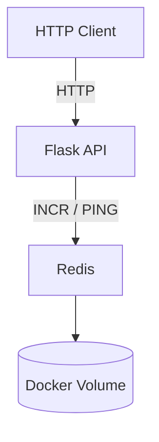

# Visit Counter API


A simple HTTP API built with Python and Flask that tracks visits using Redis. The application is containerized with Docker Compose and includes automated testing, health monitoring, and a CI pipeline using GitHub Actions.

## Architecture

The application consists of two services:

- **Flask API** – handles HTTP requests and exposes API endpoints.
- **Redis** – stores the visit counter and provides persistent data storage.



Both services run in separate containers and communicate through a Docker Compose network. Only the API is exposed to the host machine.

## Features

- REST API with three HTTP endpoints.
- Redis-based visit counter using atomic increment operations.
- Health endpoint for checking Redis availability.
- Request logging to standard output.
- Dockerized application running as a non-root user.
- Redis persistence using AOF and Docker named volumes.
- Docker healthchecks and restart policies.
- Bash HTTP healthcheck script with retry logic.
- Automated linting, testing, and Docker builds using GitHub Actions.

## API Endpoints

| Method | Endpoint | Description |
|---|---|---|
| GET | `/` | Returns a welcome message and container hostname. |
| GET | `/visits` | Increments and returns the visit counter. |
| GET | `/health` | Checks Redis availability and returns service status. |

The `/health` endpoint returns HTTP `200` when Redis is available and HTTP `503` otherwise.

## Configuration

Application settings are configured through environment variables:

| Variable | Default | Description |
|---|---|---|
| `APP_PORT` | `5000` | Application HTTP port. |
| `REDIS_HOST` | `localhost` | Redis hostname. |
| `REDIS_PORT` | `6379` | Redis port. |

Docker Compose overrides `REDIS_HOST` with `redis`, the Redis service name.

## Getting Started

### Prerequisites

Make sure the following tools are installed:

- Docker
- Docker Compose

### Clone the repository

```bash
git clone https://github.com/bambino325/visit-counter.git
cd visit-counter
```

### Configure environment

Create a local environment file from the provided example:

```bash
cp .env.example .env
```

The default configuration uses port `5000` for the API.

### Build and start services

Build the application image and start both services in the background:

```bash
docker compose up --build -d
```

The API will be available at:

`http://localhost:5000`

### Test the API

Check the available endpoints:

```bash
curl http://localhost:5000/
curl http://localhost:5000/visits
curl http://localhost:5000/health
```

Calling `/visits` multiple times will increment the stored counter.

### View service status and logs

Check whether both containers are running and healthy:

```bash
docker compose ps
```

View application and Redis logs:

```bash
docker compose logs
```

### Stop services

Stop and remove the containers and the Compose network:

```bash
docker compose down
```

The Redis named volume is preserved when using `docker compose down`. To also remove the stored Redis data, run:

```bash
docker compose down -v
```
## Testing and Code Quality

The project uses Pytest for automated testing and Ruff for linting.

Tests cover:

- Home endpoint response.
- Visit counter incrementing.
- Successful Redis health check.
- Redis connection failure handling.

A `FakeRedis` implementation is used to isolate application tests from an actual Redis server.

Run the checks locally:

```bash
pip install -r requirements-dev.txt

python -m pytest -v
ruff check .
```

## HTTP Healthcheck Script

The project includes `scripts/healthcheck.sh`, a Bash script for checking HTTP endpoint availability.

Usage:

```bash
./scripts/healthcheck.sh http://localhost:5000/health
```

The script performs up to five attempts, waits three seconds between unsuccessful attempts, and logs timestamps and HTTP status codes. It returns exit code `0` on success and `1` if all attempts fail.

## Docker Configuration

Docker Compose manages the API and Redis services.

- **Application:** Uses a lightweight Python base image, installs dependencies before copying source code, runs Gunicorn as a non-root user, and includes an HTTP-based healthcheck.
- **Redis:** Uses Redis 7.4 Alpine, enables AOF persistence, stores data in a named volume, and uses `redis-cli ping` for health monitoring.

Both services use the `unless-stopped` restart policy.

## Continuous Integration

GitHub Actions automatically runs the CI workflow on pushes and Pull Requests targeting the `main` branch.

The pipeline performs the following steps:

1. Checks out the repository.
2. Sets up Python 3.12.
3. Installs development dependencies.
4. Runs Ruff linting.
5. Executes Pytest tests.
6. Builds the Docker image.

This ensures that code changes pass basic quality checks and that the Docker image can be successfully built before integration into the main branch.

## Design Decisions

**Container image:** The application uses `python:3.12-slim` to keep the image relatively small while retaining the required Python runtime. Dependencies are installed before copying the application source code to improve Docker build cache efficiency.

**Application server:** Gunicorn is used instead of Flask's built-in development server because it is better suited for running a Flask application in a containerized environment.

**Security:** The application runs under a dedicated non-root user to follow the principle of least privilege and reduce potential security risks.

**Service separation:** The Flask application and Redis run in separate containers managed by Docker Compose. The application connects to Redis using the service name `redis` over the internal Compose network. Redis is not directly exposed to the host machine.

**Data persistence:** Redis uses AOF persistence, while a Docker named volume stores its data independently of the Redis container lifecycle. This allows the visit counter to survive container recreation.

**Health monitoring:** Both services have Docker healthchecks. The application health endpoint also verifies Redis availability, so its health status reflects the availability of its main dependency.

**Automated validation:** GitHub Actions runs linting, automated tests, and a Docker image build on pushes and pull requests targeting `main`, helping detect issues before changes are merged.

**Testing strategy:** Unit tests use a `FakeRedis` implementation to isolate application logic from the external Redis service. This keeps the tests fast and independent of the runtime environment.


## Challenges and Solutions

**1. Isolating application tests from Redis**

A direct dependency on a running Redis server would make tests more complex.

*Solution:* Implemented an application factory with dependency injection, allowing tests to use a `FakeRedis` implementation.

**2. Container-to-container communication**

Using `localhost` inside the application container would point to the application itself, not Redis.

*Solution:* Used Docker Compose service discovery, allowing the application to connect to Redis through the hostname `redis`.

**3. Data persistence across container recreation**

Removing a container should not result in losing the visit counter.

*Solution:* Enabled Redis AOF persistence and mounted its data directory to a Docker named volume.


## Future Improvements

- **Multi-stage Docker builds:** Further optimize the final image by separating dependency installation from the runtime environment.
- **Rate limiting:** Introduce request limits to prevent excessive API usage and abuse.
- **Monitoring and observability:** Extend the existing request logging and healthchecks with response-time metrics, error statistics, and Prometheus/Grafana integration.
- **Container security scanning:** Integrate Trivy into the CI pipeline to detect known vulnerabilities in container images and dependencies.
- **Makefile:** Simplify common development and Docker Compose commands through reusable targets.
